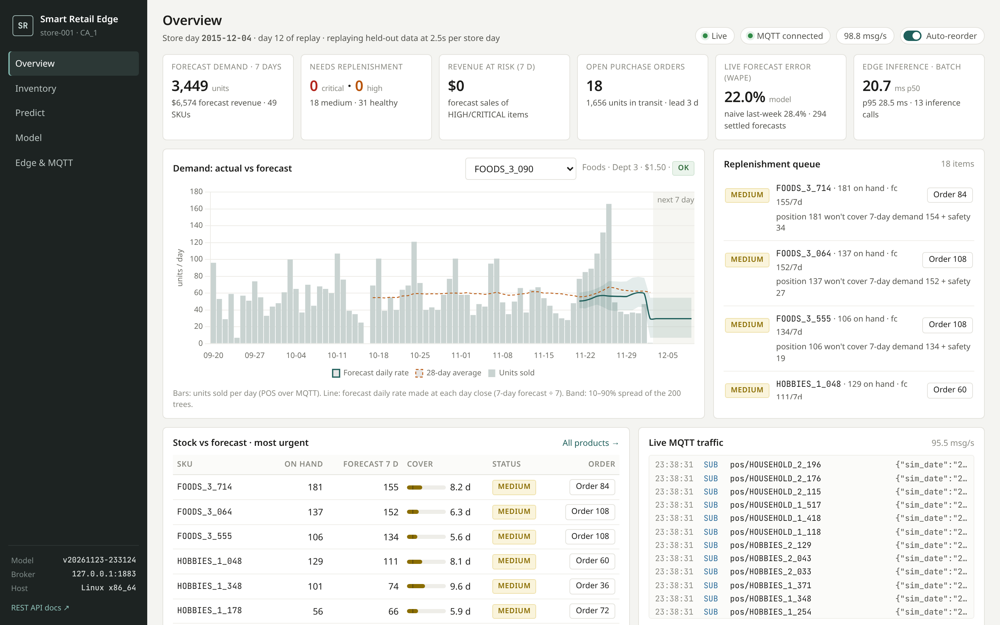
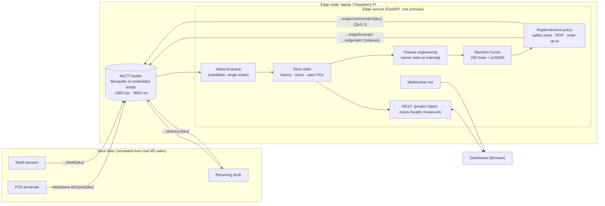
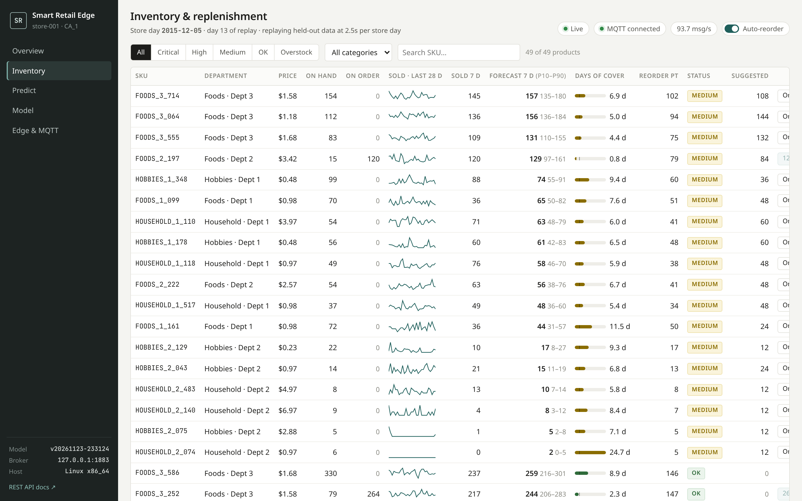
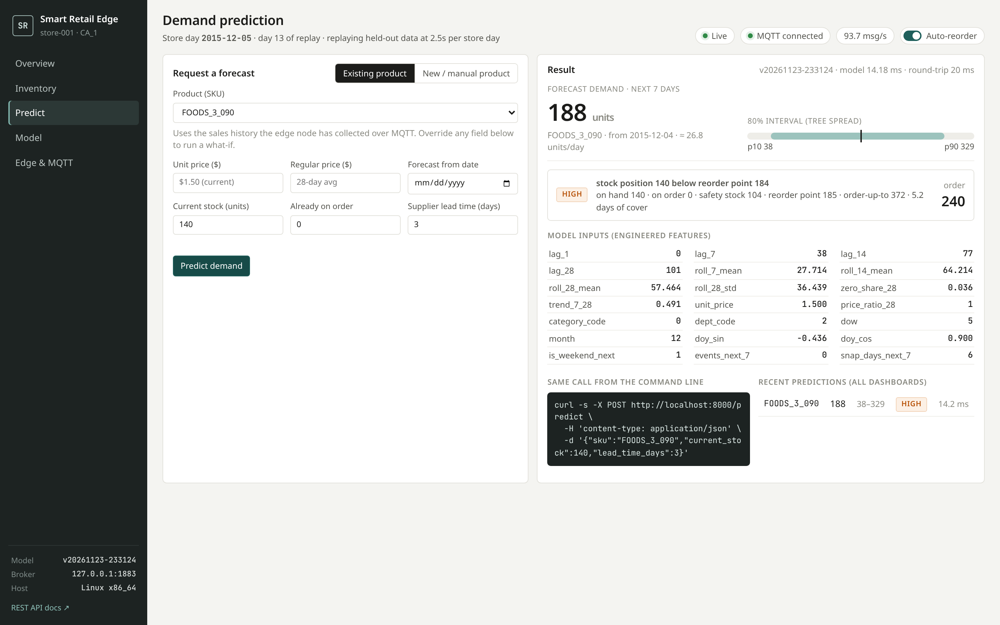
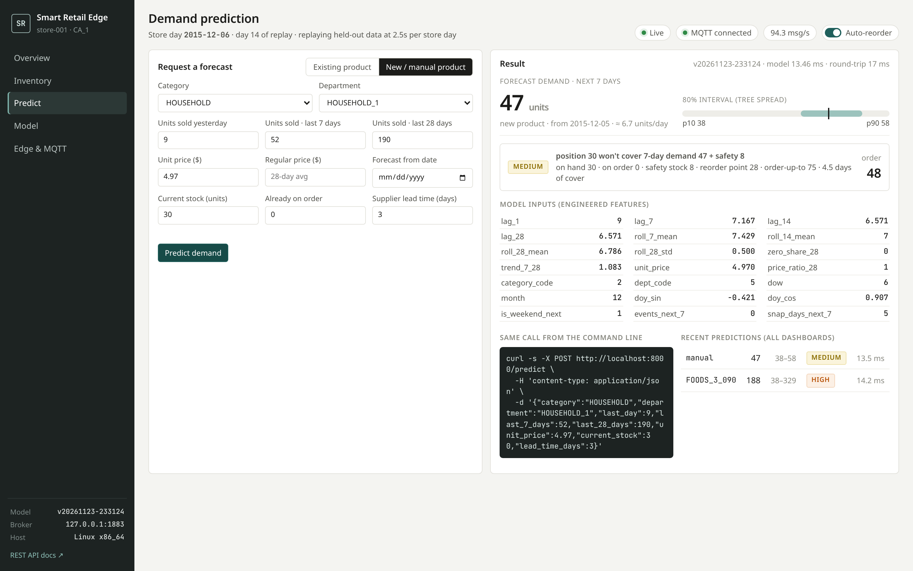
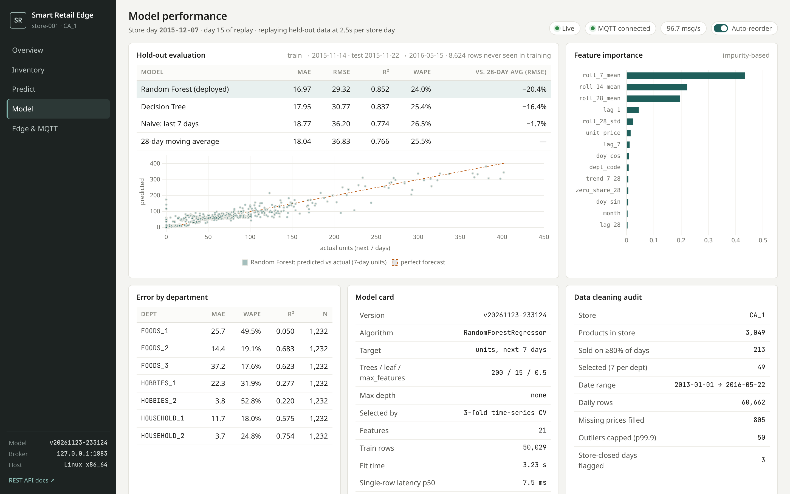
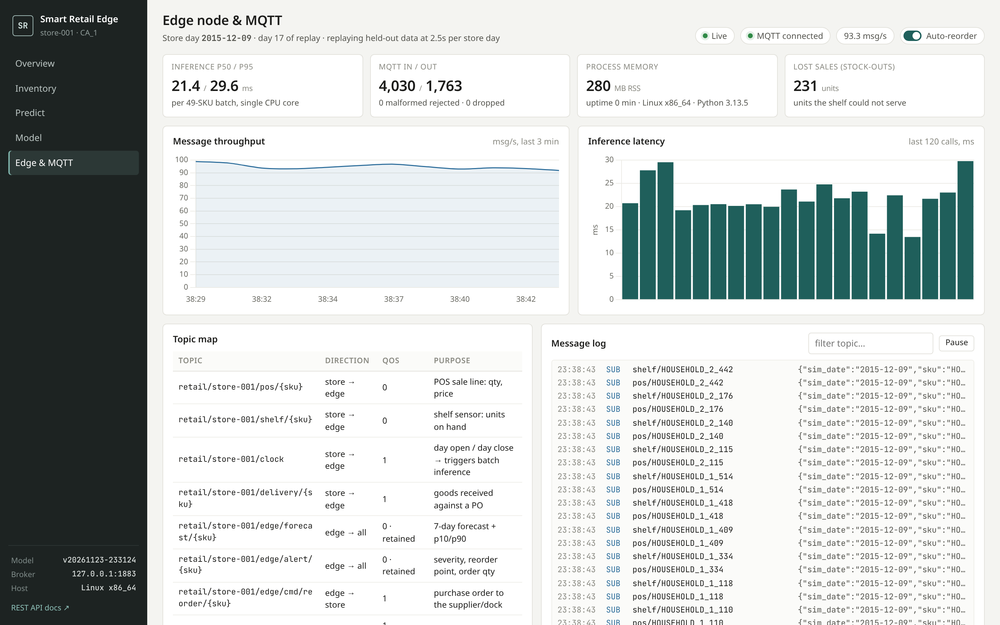
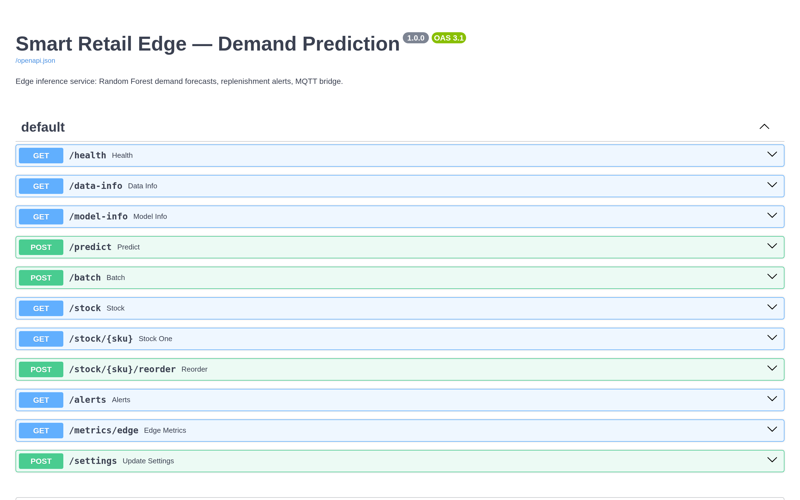

# Smart Retail Edge: Product Demand Prediction & Replenishment

An edge analytics system for a retail store. It forecasts each product's demand for the next 7 days with a **Random Forest Regressor**, compares the forecast with live shelf stock, and raises **replenishment alerts and purchase orders**. Everything runs **on the store's own hardware** (a laptop or Raspberry Pi), talking **MQTT** to point-of-sale terminals and shelf sensors and **HTTP/WebSocket** to a live dashboard.



| | |
|---|---|
| **Dataset** | M5 Forecasting (Walmart), store `CA_1`, 49 products across all 7 departments, 2013-01-01 → 2016-05-22 (60,662 product-days) |
| **Model** | `RandomForestRegressor` (200 trees, hyper-parameters chosen by time-series cross-validation), with a Decision Tree and two naive baselines for comparison |
| **Hold-out result** | R² **0.852**, WAPE **24.0 %**, RMSE **29.3** vs 36.8 for a 28-day moving average (**−20 %**) |
| **Edge inference** | about 8 ms for one product, about 20 ms for a 49-product batch with prediction intervals, on 1 CPU core, ~280 MB RSS |
| **Communication** | MQTT 3.1.1 (POS, shelf sensors, clock, deliveries → edge; forecasts, alerts, purchase orders ← edge), REST over HTTP, WebSocket push to the dashboard |
| **Run** | `./run.sh` (Linux/macOS/Pi), `run.bat` (Windows), or `docker compose up` |

Demo video: [`media/demo.mp4`](media/demo.mp4)

---

## Architecture



**How one store day moves through the system**

1. The simulator replays one real trading day from the test period, which the model never trained on. Each product's sales are split into intraday POS batches and capped by what is physically on the shelf, so a stock-out becomes a lost sale. Every sale is followed by a shelf-sensor reading.
2. At `day_close` the edge appends the day to each product's history. It builds 21 features per product, runs **one batched inference** for all 49 products, and gets a point forecast plus a 10–90 % interval from the spread across the trees.
3. The replenishment policy turns each forecast into a severity and an order quantity. The edge then publishes retained forecast and alert topics. With auto-reorder on, it also sends a purchase order, which the dock delivers after the lead time.
4. Seven days later each forecast is scored against what actually sold. The dashboard shows this **live accuracy** next to a naive baseline.

### MQTT topic map

| Topic | Direction | QoS | Payload |
|---|---|---|---|
| `retail/{store}/pos/{sku}` | store → edge | 0 | `{sim_date, sku, qty, price}` |
| `retail/{store}/shelf/{sku}` | store → edge | 0 | `{sku, on_hand}` |
| `retail/{store}/clock` | store → edge | 1 | `{sim_date, event: day_open|day_close}` |
| `retail/{store}/delivery/{sku}` | store → edge | 1 | `{sku, qty, po}` |
| `retail/{store}/edge/forecast/{sku}` | edge → all | 0, retained | `{pred_7d, p10, p90, origin, model_version}` |
| `retail/{store}/edge/alert/{sku}` | edge → all | 0, retained | `{severity, on_hand, reorder_point, order_qty, reason…}` |
| `retail/{store}/edge/cmd/reorder/{sku}` | edge → store | 1 | `{po, sku, qty, lead_time_days}` |
| `retail/{store}/edge/status` | edge → all | 1, retained, **LWT** | `{state: online|offline}` |

---

## Machine learning

### Data and cleaning (`retail_edge/data.py`)
* **Source:** M5 Forecasting Accuracy (University of Nicosia / Kaggle, 2020), from the open Zenodo mirror [10.5281/zenodo.12636070](https://doi.org/10.5281/zenodo.12636070) (CC BY 4.0). It is downloaded automatically, with no Kaggle login.
* **Scope:** one store (`CA_1`) acts as the edge node, the way a real deployment runs one model per store.
* **Product selection:** products sold on at least 80 % of days (213 of 3,049), then the 7 highest-volume in each of the 7 departments, giving 49 SKUs that span Foods, Hobbies and Household.
* **Cleaning, with every step counted in `data/cleaning_report.json`:**
  * wide → long reshape
  * weekly prices joined to days, with 805 missing prices forward/back-filled
  * Christmas store closures detected (all products at 0) and flagged
  * per-item outliers capped at the 99.9th percentile (50 values)

### Features (`retail_edge/features.py`)
| Group | Features |
|---|---|
| Previous sales | `lag_1, lag_7, lag_14, lag_28`, rolling mean 7/14/28, rolling std 28, share of zero-sale days, short/long trend ratio |
| Product | unit price, price ÷ 28-day average price (promotion signal), category code, department code |
| Date & seasonality | day of week, month, day-of-year sin/cos, weekend flag |
| Known-ahead calendar | number of holidays/events and SNAP days in the next 7 days |

The **same function** builds features for training and for live inference. `tests/test_features.py` asserts that the vectorised training frame and the per-request path agree row by row, so train/serve skew is caught by tests.

**Target:** units sold over the next 7 days, which is the replenishment horizon.

### Training and evaluation (`retail_edge/train.py`)
* **Time-based split.** Train ends 2015-11-14 and test runs 2015-11-22 → 2016-05-15 (the last ~6 months). There is a **7-day purge gap**, so no training target window overlaps the test period.
* **Hyper-parameters** are chosen with 3-fold expanding-window `TimeSeriesSplit`, with a fixed seed of 42. Two runs give identical metrics, and that is covered by a test.
* **Artifacts** are versioned in `models/vYYYYMMDD-HHMMSS/`: `model.joblib`, `decision_tree.joblib` and `metadata.json`. The metadata records the metrics, CV results, importances, per-SKU residual σ, latency and dataset hash. `models/LATEST` points at the deployed version.

| Model (test set, 8,624 product-days) | MAE | RMSE | R² | WAPE |
|---|---:|---:|---:|---:|
| **Random Forest (deployed)** | **16.97** | **29.32** | **0.852** | **24.0 %** |
| Decision Tree | 17.95 | 30.77 | 0.837 | 25.4 % |
| Naive: last 7 days | 18.77 | 36.20 | 0.774 | 26.5 % |
| 28-day moving average | 18.04 | 36.83 | 0.766 | 25.5 % |

The most important features are `roll_7_mean` (0.43), `roll_14_mean` (0.22), `roll_28_mean` (0.20), `lag_1`, `roll_28_std` and `unit_price`. Recent sales level dominates, as expected for short-horizon retail demand. Price and calendar effects refine it.

**Honest limits:**
* Fresh food (`FOODS_1`) and seasonal hobbies (`HOBBIES_2`) are the hardest departments (WAPE about 50 %), because they are intermittent and promotion-driven.
* The model sees one store only.
* Live accuracy on the dashboard is measured against *sold* units, which stock-outs censor.

### Replenishment policy (`retail_edge/inventory.py`)
```
d   = forecast_7d / 7                 daily rate
SS  = z · σ_daily · √L                safety stock (σ from the model's per-SKU test residuals, z = 1.65 ≈ 95 %)
ROP = d · L + SS                      reorder point, L = supplier lead time (3 days)
S   = forecast_7d + d · L + SS        order-up-to level
Q   = ceil_case_pack(S − on_hand − on_order)
```
**Severity:**
* **CRITICAL**: the shelf empties before a delivery could arrive.
* **HIGH**: stock position is below the reorder point.
* **MEDIUM**: stock won't cover the next 7 days plus safety stock.
* **OVERSTOCK**: more than 6 weeks of cover.

---

## Edge deployment and robustness

* **One process, one writer.** MQTT callbacks only put messages on a queue. A single asyncio task mutates the state, so HTTP, MQTT and inference never race.
* **Malformed input never crashes the edge.**
  * Bad JSON, negative quantities and unknown SKUs are counted (`rejected`) and logged.
  * HTTP input is validated with Pydantic (types, ranges, category/department consistency, `extra=forbid`) and returns structured 422 errors.
  * `/batch` reports failures per item.
* **Broker outages:**
  * paho auto-reconnects with back-off.
  * A Last Will publishes `offline`.
  * The REST API keeps serving predictions with no broker, and a reorder returns 503 rather than silently dropping.
* **Slow dashboards can't stall the edge.** Each WebSocket client has a bounded queue that drops its oldest message when full. The browser reconnects with exponential back-off.
* **Small footprint.**
  * Inference is pinned to 1 thread for predictable latency.
  * Latency p50/p95/p99 is tracked live.
  * The Docker service is capped at 1 CPU and 512 MB, i.e. Raspberry Pi class.
* **Reproducible.** The seed is fixed, the processed dataset is committed (`data/`, 208 KB), the raw data downloads on demand, and the model retrains in about 20 s.

## Run it

```bash
./run.sh                       # creates .venv, trains if needed, starts broker + edge + simulator
# Dashboard  http://localhost:8000      REST docs  http://localhost:8000/docs
SIM_DAY_SECONDS=2 ./run.sh     # faster replay
EMBEDDED_BROKER=0 MQTT_HOST=192.168.1.20 ./run.sh   # use an existing Mosquitto
```
Windows: `run.bat`. Docker (Mosquitto + edge + simulator): `docker compose up --build`.

Rebuild everything from the raw data:
```bash
python -m retail_edge.data     # download M5 (48 MB) + clean + select products
python -m retail_edge.train    # CV, fit, evaluate, version the model
pytest -q                      # 42 tests: features, model, policy, API validation, MQTT end-to-end
```

### REST API
| Method | Path | Purpose |
|---|---|---|
| GET | `/health` | status, model version, broker connection, memory |
| GET | `/model-info` | metrics, hyper-parameters, importances (`?sample=true` adds test predictions) |
| GET | `/data-info` | data-cleaning audit |
| POST | `/predict` | forecast for a known `sku` (live history), or a new product from category, price and recent sales; returns p10/p90 + replenishment recommendation |
| POST | `/batch` | up to 500 predictions, with per-item errors |
| GET | `/stock`, `/stock/{sku}` | live stock vs forecast, severity, history; filter `?severity=CRITICAL,HIGH` |
| POST | `/stock/{sku}/reorder` | send a purchase order over MQTT |
| GET | `/alerts`, `/metrics/edge` | alert log; latency and MQTT counters |
| POST | `/settings` | auto-reorder, lead time, service level |
| WS | `/ws` | live push to the dashboard |

```bash
curl -s -X POST localhost:8000/predict -H 'content-type: application/json' \
  -d '{"category":"HOUSEHOLD","department":"HOUSEHOLD_1","unit_price":3.97,"last_day":9,"last_7_days":52,"last_28_days":190,"current_stock":30}'
```

## Screenshots
| | |
|---|---|
|  |  |
|  |  |
|  |  |

## Repository layout
```
retail_edge/   data.py  features.py  train.py  model.py  inventory.py  state.py  service.py
               schemas.py  topics.py  broker.py  simulator.py  config.py
web/           index.html  app.js  style.css  vendor/chart.umd.min.js   (no build step, works offline)
tests/         test_features.py  test_model.py  test_inventory.py  test_api.py  test_mqtt.py
scripts/       capture_screenshots.py  record_demo.py
data/          processed daily sales, catalog, event calendar, cleaning report
deploy/        mosquitto.conf          Dockerfile  docker-compose.yml  run.sh  run.bat
```

## Dataset citation
Makridakis, S., Spiliotis, E., Assimakopoulos, V. (2022). *M5 accuracy competition: Results, findings, and conclusions.* International Journal of Forecasting 38(4). Data: Kaggle M5 Forecasting Accuracy, mirrored at Zenodo, doi:10.5281/zenodo.12636070 (CC BY 4.0).
